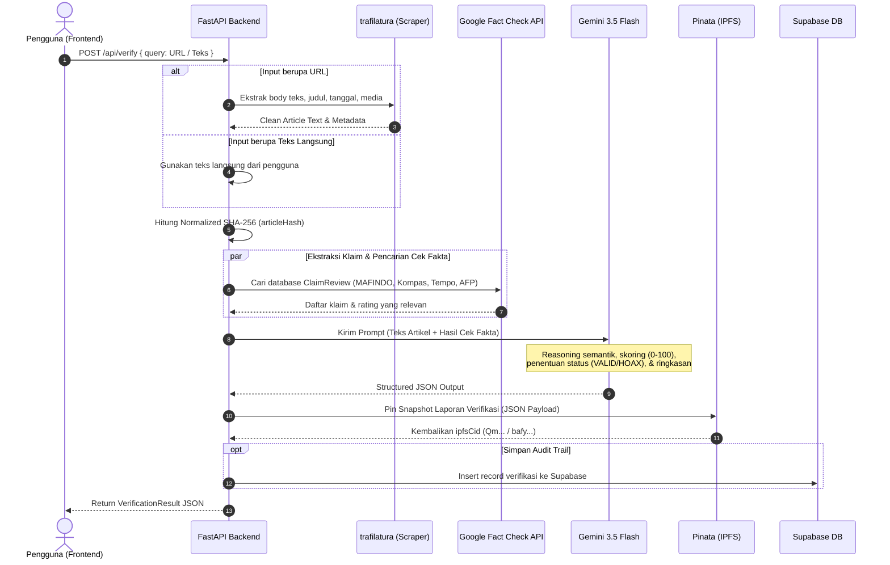

# VeritasChain — Backend Workflow & Architecture Guide

Dokumen ini adalah panduan teknis implementasi backend **FastAPI (Python 3.12)** untuk sistem verifikasi berita terdesentralisasi **VeritasChain**. Backend bertindak sebagai orkestrator antara antarmuka pengguna (Frontend), mesin pencari cek fakta, kecerdasan buatan (Gemini 3.5 Flash), dan penyimpanan terdesentralisasi (IPFS via Pinata).

---

## 1. Arsitektur & Alur Kerja (Workflow Diagram)



---

## 2. Struktur Direktori Rekomendasi (`Backend/`)

```text
Backend/
├── main.py                  # Entrypoint FastAPI, CORS Middleware, & Router
├── config.py                # Konfigurasi Pydantic / python-dotenv
├── requirements.txt         # Daftar paket dependensi Python
├── BACKEND_WORKFLOW.md      # Dokumentasi alur kerja backend (file ini)
├── services/
│   ├── scraper.py           # Ekstraksi badan teks berita bersih & hashing SHA-256
│   ├── fact_check.py        # Klien Google Fact Check Tools API (ClaimReview)
│   ├── ai_verifier.py       # Prompting & reasoning Gemini 3.5 Flash (google-genai SDK)
│   ├── ipfs_service.py      # Pinning payload verifikasi ke IPFS via Pinata API
│   └── diff_tracker.py      # Visual diff & perbandingan hash untuk artikel revisi
└── schemas/
    └── verification.py      # Schema Pydantic request & response (cocok dengan Frontend)
```

---

## 3. Spesifikasi Endpoint REST API

### A. Endpoint Utama: Verifikasi Berita
* **Endpoint**: `POST /api/verify`
* **Request Body**:
  ```json
  {
    "query": "https://news-portal.com/artikel-terbaru",
    "mode": "url" // "url" | "text"
  }
  ```
* **Response Body** *(Sesuai spesifikasi `Frontend/src/types/index.ts`)*:
  ```json
  {
    "url": "https://news-portal.com/artikel-terbaru",
    "title": "Judul Berita yang Diekstrak",
    "publisher": "Portal Berita X",
    "publishedDate": "2026-11-20T10:00:00Z",
    "articleHash": "e3b0c44298fc1c149afbf4c8996fb92427ae41e4649b934ca495991b7852b855",
    "credibilityScore": 85,
    "status": "VALID", // "VALID" | "QUESTIONABLE" | "HOAX"
    "summary": "Artikel ini memuat informasi yang selaras dengan rilis resmi instansi terkait...",
    "keyFindings": [
      "Klaim A didukung oleh data statistik resmi.",
      "Konteks waktu dan lokasi peristiwa telah sesuai.",
      "Tidak ditemukan manipulasi kutipan narasumber."
    ],
    "claimsReview": [
      {
        "claim": "Klaim spesifik yang diperiksa",
        "claimant": "Pihak yang mengklaim",
        "reviewPublisher": "TurnBackHoax MAFINDO",
        "reviewUrl": "https://turnbackhoax.id/...",
        "rating": "Benar"
      }
    ],
    "ipfsCid": "bafybeigdyrzt5sfp7udm7hu76uh7y26nf3efuylqabf3oclgtqy55fbzdi",
    "txHash": null,
    "network": "Ethereum Sepolia",
    "timestamp": "2026-11-21T14:00:00Z"
  }
  ```

---

### B. Endpoint Pelacakan Revisi (Change Tracking)
* **Endpoint**: `POST /api/rescan`
* **Request Body**:
  ```json
  {
    "url": "https://news-portal.com/artikel-terbaru",
    "originalHash": "e3b0c44298fc1c149afbf4c8996fb92427ae41e4649b934ca495991b7852b855"
  }
  ```
* **Response Body**:
  ```json
  {
    "url": "https://news-portal.com/artikel-terbaru",
    "currentHash": "a1b2c3...",
    "hasRevisions": true,
    "diffSummary": {
      "addedWords": 14,
      "removedWords": 8,
      "diffHtml": "<span>Teks asli <del class='text-red-500'>lama</del> diganti <ins class='text-green-500'>baru</ins></span>"
    }
  }
  ```

---

## 4. Rincian Teknis Tiap Modul Service

### 1. `scraper.py` (Ekstraksi Artikel Bersih)
* Menggunakan pustaka `trafilatura` untuk mengambil teks utama tanpa gangguan iklan, navigasi, dan footer.
* Melakukan **Deterministic Normalization**:
  * Menghapus whitespace berlebih, newline acak, dan zero-width space.
  * Menghitung SHA-256 dari teks hasil normalisasi:
  ```python
  import hashlib
  import trafilatura

  def extract_article(url: str):
      downloaded = trafilatura.fetch_url(url)
      text = trafilatura.extract(downloaded, include_comments=False)
      metadata = trafilatura.extract_metadata(downloaded)
      # Normalisasi
      clean_text = " ".join(text.split())
      article_hash = hashlib.sha256(clean_text.encode('utf-8')).hexdigest()
      return clean_text, article_hash, metadata
  ```

### 2. `fact_check.py` (Google Fact Check Tools API)
* Memanggil endpoint Google Fact Check:
  `GET https://factchecktools.googleapis.com/v1alpha1/claims:search?query={keyword}&key={FACT_CHECK_API_KEY}&languageCode=id`
* Memetakan respons `ClaimReview` ke model data `FactCheckClaim`.

### 3. `ai_verifier.py` (Gemini 3.5 Flash)
* Menggunakan SDK modern `google-genai`:
  ```python
  from google import genai
  from google.genai import types

  client = genai.Client(api_key=os.getenv("GEMINI_API_KEY"))

  def analyze_content(title: str, text: str, fact_checks: list):
      prompt = f"""
      Analisis kredibilitas berita berikut secara kritis dan objektif.
      Judul: {title}
      Teks Berita: {text[:4000]}
      Referensi Cek Fakta Ditemukan: {fact_checks}

      Kembalikan respon dalam format JSON dengan field:
      - credibilityScore (integer 0-100)
      - status ("VALID" / "QUESTIONABLE" / "HOAX")
      - summary (string, max 3 kalimat ringkas)
      - keyFindings (array of string, 3 poin utama)
      """
      response = client.models.generate_content(
          model='gemini-3.5-flash',
          contents=prompt,
          config=types.GenerateContentConfig(response_mime_type="application/json")
      )
      return response.text
  ```

### 4. `ipfs_service.py` (Pinata IPFS)
* Menyimpan payload verifikasi permanen ke IPFS:
  ```python
  import httpx

  async def pin_to_ipfs(payload: dict):
      url = "https://api.pinata.cloud/pinning/pinJSONToIPFS"
      headers = {
          "Authorization": f"Bearer {os.getenv('PINATA_JWT')}",
          "Content-Type": "application/json"
      }
      async with httpx.AsyncClient() as client:
          res = await client.post(url, json=payload, headers=headers)
          data = res.json()
          return data.get("IpfsHash")
  ```

---

## 5. Variabel Lingkungan yang Dibutuhkan (`.env`)

Backend membaca konfigurasi dari file [.env](file:///d:/Tahu-Bulat-Paijo/.env):
* `GEMINI_API_KEY`: Kunci Google AI Studio (Gemini 3.5 Flash)
* `FACT_CHECK_API_KEY`: Kunci Google Fact Check Tools API
* `PINATA_JWT`: Token otentikasi Pinata Cloud
* `SUPABASE_URL` & `SUPABASE_SERVICE_ROLE_KEY`: Kredensial database Supabase
