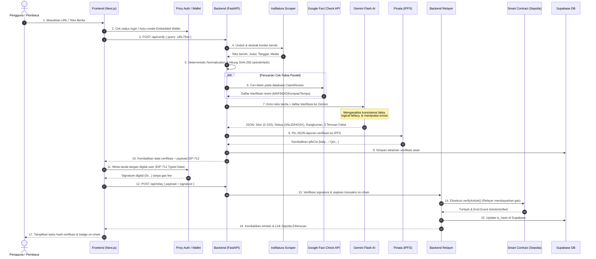
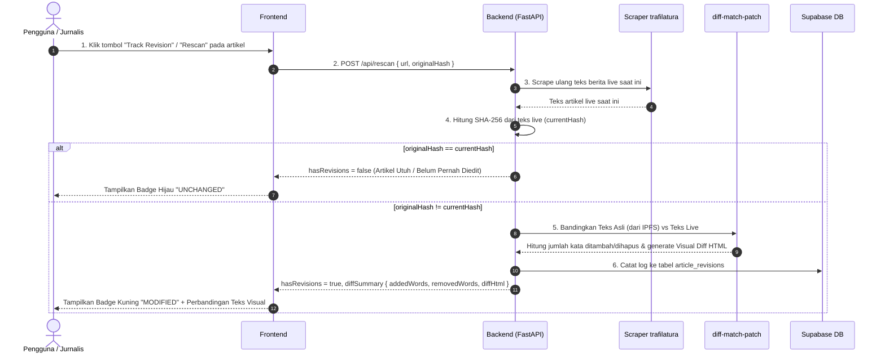
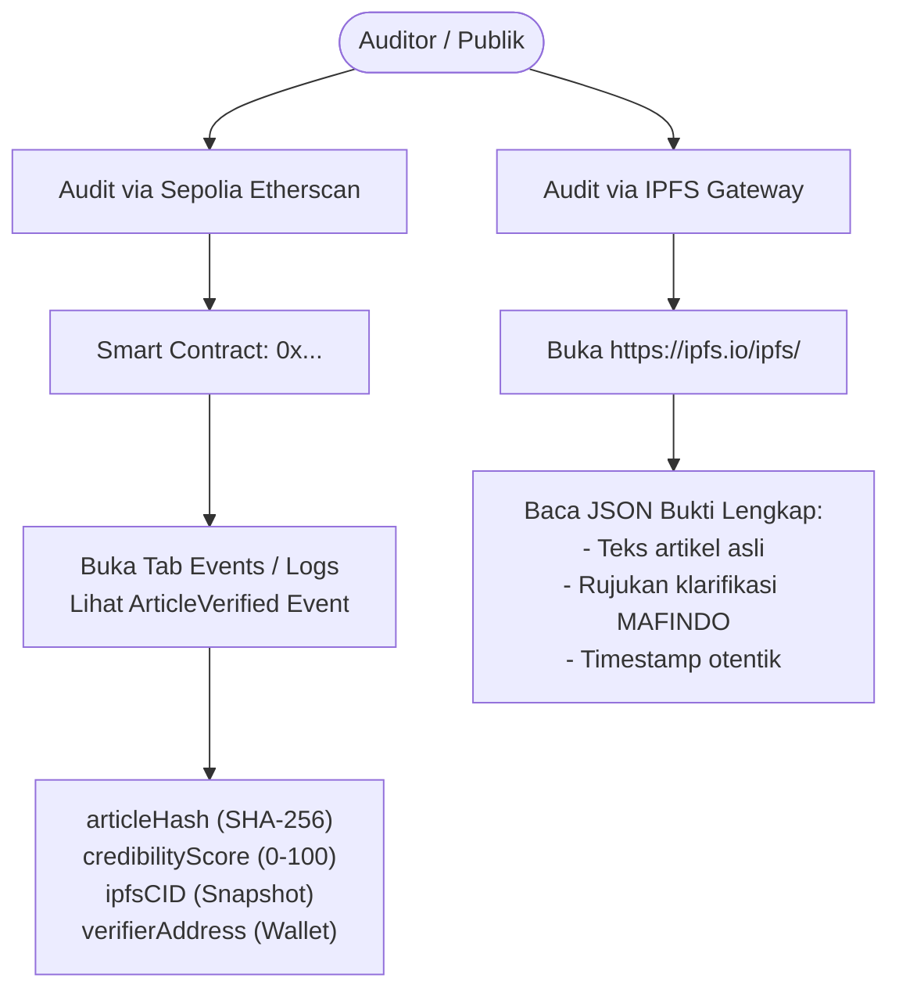

# VeritasChain — Spesifikasi Alur Sistem Mendalam (End-to-End Detail Flow)

Dokumen ini menjelaskan secara teknis dan mendalam seluruh alur kerja (*end-to-end flow*) platform **VeritasChain: Decentralized News Verification and Article Change Tracking**.

---

## 1. Peta Komponen Sistem & Lapisan Teknologi

Platform VeritasChain dibangun atas **5 lapisan fungsional**:

1. **Client & Presentation Layer**:
   * **Framework**: React / Next.js 16 (App Router) + TypeScript + Tailwind CSS
   * **Web3 Client**: Viem + Wagmi
   * **Identity & Onboarding**: Privy SDK (`@privy-io/react-auth`) untuk autentikasi 1-klik & embedded wallet non-custodial.
2. **Gateway & Orchestration Layer (Backend)**:
   * **Framework**: Python 3.12 + FastAPI + Uvicorn (Async I/O)
   * **Scraper Engine**: `trafilatura` (ekstraksi teks bebas iklan)
   * **Diff Engine**: Google `diff-match-patch`
3. **Intelligence & Fact Checking Layer**:
   * **AI Reasoning Engine**: Google Gemini Flash via SDK `google-genai`
   * **Fact Database Engine**: Google Fact Check Tools API (Standar Schema.org `ClaimReview`) mencakup MAFINDO, Kompas, Tempo, Liputan6, AFP, dan Tirto.
4. **Decentralized Storage & Ledger Layer**:
   * **Penyimpanan Snapshot**: IPFS (InterPlanetary File System) via Pinata API
   * **Ledger Publik**: Ethereum Sepolia Testnet
   * **Smart Contract**: Solidity 0.8.28 (`VeritasChain.sol`) dengan target EVM Cancun/Prague
   * **Public Explorer**: Sepolia Etherscan
5. **Fast Indexing Layer**:
   * **Database**: Supabase PostgreSQL + Row Level Security (RLS)

---

## 2. Alur 1: Verifikasi Berita Baru (New Article Verification Pipeline)

Alur ini berjalan ketika pengguna memasukkan tautan atau teks berita untuk diuji kredibilitasnya dan dicatat ke blockchain.

### Rincian Teknis Tiap Langkah:
1. **Ekstraksi Bersih (`trafilatura`)**:
   * Menyingkirkan markup HTML, script pelacak, banner promosi, dan komentar pembaca.
   * Hanya menyisakan teks berita esensial.
2. **Deterministic SHA-256 Hashing**:
   * Teks dinormalisasi: seluruh spasi ganda, baris baru acak, dan spasi kosong di ujung teks dihilangkan (`" ".join(text.split())`).
   * Dihasilkan hash deterministik: perubahan 1 huruf saja pada teks artikel di masa depan akan menghasilkan hash yang berbeda total.
3. **Standar `ClaimReview`**:
   * Memanfaatkan konsorsium cek fakta bersertifikasi IFCN (*International Fact-Checking Network*). Jika artikel membahas hoaks yang sudah pernah dibantah MAFINDO atau Tempo, bantahan tersebut langsung diidentifikasi.
4. **Penalaran Semantik (Gemini Flash)**:
   * Menggunakan model `gemini-3.5-flash-lite` dengan format keluaran terstruktur JSON (*Structured Output*).
   * Menghasilkan skor 0–100, status klasifikasi (`VALID` $\ge 70$, `QUESTIONABLE` $40-69$, `HOAX` $< 40$), rangkuman ringkas, dan 3 temuan fakta terpenting.
5. **Pengarsipan Snapshot IPFS**:
   * Snapshot disimpan dengan format JSON standar di jaringan terdistribusi IPFS melalui Pinata Cloud. Sekalipun media asal menghapus artikel tersebut dari internet (*link rot*), arsip bukti teks aslinya tetap abadi.
6. **Gasless Meta-Transaction (EIP-712)**:
   * Pengguna mengonfirmasi pencatatan berita tanpa membayar ETH. Tanda tangan EIP-712 membuktikan bahwa wallet pengguna secara sah menyetujui hasil verifikasi ini, sementara backend relayer mensponsori biaya gas ke Ethereum Sepolia.

---

## 3. Alur 2: Pelacakan Perubahan Berita (Stealth Edit Tracking Pipeline)

Alur ini dirancang untuk membongkar praktik media yang merevisi isi berita secara diam-diam tanpa ada catatan transparansi redaksi.

### Visual Diff Output:
* **Teks Merah Tercoret (`<del class="line-through text-red-500">`)**: Kalimat atau klaim yang diam-diam **dihapus** oleh redaksi media.
* **Teks Hijau Bergaris Bawah (`<ins class="underline text-emerald-500">`)**: Kalimat atau keterangan baru yang **disisipkan** secara diam-diam.

---

## 4. Alur 3: Audit Publik Terdesentralisasi (Public Audit Flow)

Keunggulan utama VeritasChain adalah independensi audit: publik, juri, atau akademisi tidak perlu bergantung pada server VeritasChain untuk membuktikan keaslian laporan.

---

## 5. Ringkasan Siklus Hidup Data (Data Lifecycle)

| Tahap | Tempat Penyimpanan | Karakteristik | Tujuan |
| :--- | :--- | :--- | :--- |
| **Ekstraksi Mentah** | Memori Backend (RAM) | Sementara (Ephemeral) | Parsing & normalisasi teks bersih |
| **Snapshot Bukti** | IPFS (Pinata) | Terdistribusi & Permanen | Mengarsipkan teks berita asli agar kebal penghapusan |
| **Segel Kriptografis** | Ethereum Sepolia Smart Contract | Abadi, Transparan, Anti-Sensor | Membuktikan skor, hash artikel, dan waktu verifikasi |
| **Indeks Aplikasi** | Supabase PostgreSQL | Terindeks & Cepat Di-query | Riwayat verifikasi user, statistik, dan pencarian dashboard |
