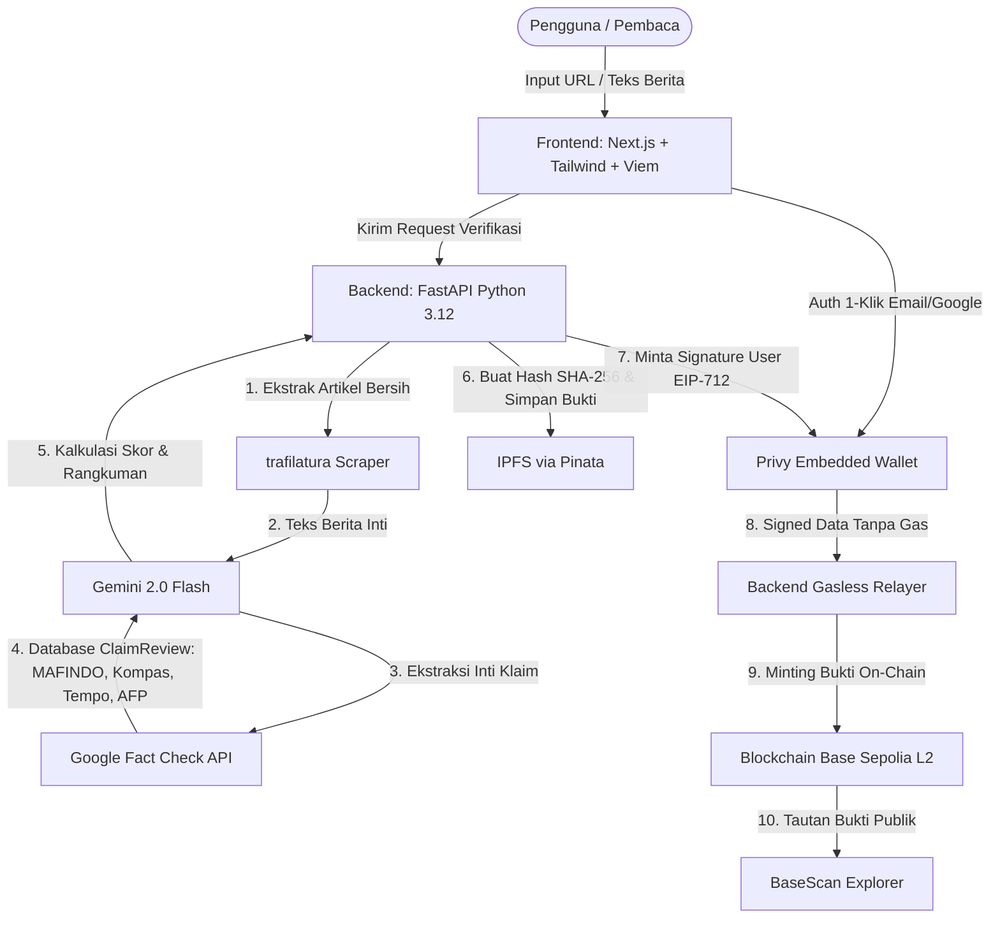

# VeritasChain: Tech Stack & System Architecture

Dokumen ini berisi perbandingan lengkap antara **Tech Stack Awal (dari Proposal HackSphere 2026)** dengan **Tech Stack Upgraded (Rekomendasi Modern & Standar Industri)** untuk platform verifikasi berita terdesentralisasi **VeritasChain**.

---

## Tabel Perbandingan Komparatif (Lama vs Baru)

| Kategori / Lapisan | Tech Stack Lama (Proposal PDF) | Tech Stack Baru (Upgraded) | Alasan Perubahan & Keuntungan Teknis |
| :--- | :--- | :--- | :--- |
| **Frontend Framework** | HTML5 + Vanilla JavaScript (ES6+) | **React (Next.js 14+ / Vite) + TypeScript** | SDK resmi Privy berbasis React; mencegah *spaghetti code* saat menangani state Web3 dan antarmuka reaktif. |
| **Styling & Desain UI** | Vanilla CSS3 | **Tailwind CSS + Lucide Icons** | Desain *dark-tech* Gemini-style yang presisi, sistem token konsisten tanpa *magic numbers*, dan anti-emoji klise. |
| **Web3 Client Library** | Ethers.js v6 | **Viem + Wagmi** | Ukuran *bundle* 4x lebih ringan dari Ethers, performa eksekusi lebih tinggi, dan *type-safe* untuk tanda tangan EIP-712. |
| **Change Detection (Diff)** | Status biner (*Unchanged* vs *Modified*) | **SHA-256 + `diff-match-patch` (Visual Red/Green)** | Menyorot kalimat/kata yang diedit atau dihapus secara diam-diam oleh media langsung di layar secara visual. |
| **Autentikasi & Wallet** | Privy *(Email / Google login)* | **Privy (`@privy-io/react-auth`)** | *(Dipertahankan)* Onboarding Web3 termudah tanpa seed phrase/ekstensi; integrasi React jauh lebih mulus. |
| **Backend Service** | Python 3.12 + FastAPI + HTTPX | **Python 3.12 + FastAPI + HTTPX (Async I/O)** | *(Dipertahankan)* Cepat, ringan, dan andal untuk *asynchronous pipeline* AI dan Web3. |
| **Web Article Scraper** | BeautifulSoup4 murni | **`trafilatura` + HTTPX** | Ekstraksi badan teks berita bersih dan metadata tanggal tanpa terganggu banner iklan atau menu navigasi. |
| **Sumber Data Cek Fakta** | RSS Feed MAFINDO via `feedparser` | **Google Fact Check Tools API (`ClaimReview`)** | **Upgrade Krusial:** Otomatis mencakup **MAFINDO, Kompas, Tempo, Liputan6, AFP, dan Tirto** dalam 1 API resmi berbasis search (bukan RSS terbatas 10–20 berita). |
| **Mesin AI & Skoring** | Google Gemini 2.0 Flash | **Gemini 2.0 Flash + Streaming Response (SSE)** | Menambahkan respons *streaming* agar analisis muncul real-time di layar pengguna (persepsi latensi <1 detik). |
| **Integritas Kriptografi** | Deterministic SHA-256 | **Deterministic Normalized SHA-256** | *(Dipertahankan)* Standar industri untuk membuktikan keaslian teks artikel secara matematis. |
| **Penyimpanan Terdesentralisasi**| IPFS via Pinata | **IPFS via Pinata** | *(Dipertahankan)* Menyimpan snapshot teks artikel dan bukti laporan verifikasi permanen (IPFS CID). |
| **Jaringan Blockchain** | Ethereum Sepolia (Layer-1) | **Base Sepolia (Ethereum Layer-2 by Coinbase)** | **Upgrade Krusial:** Konfirmasi blok hanya **1–2 detik** (L1 butuh ~12 detik) dan biaya gas **100x lebih murah (<$0.001 per tx)**. |
| **Mekanisme Bebas Gas** | EIP-712 Meta-Transaction Relayer | **EIP-712 Meta-Transaction + Paymaster** | *(Dipertahankan)* Pengguna tidak perlu punya saldo ETH untuk mencatatkan hasil verifikasi ke blockchain. |
| **Explorer Publik** | Sepolia Etherscan | **BaseScan (Sepolia)** | Explorer resmi jaringan Base untuk audit bukti keaslian secara publik tanpa perlu login. |

---

## Diagram Alur Arsitektur Sistem Baru

---

## Rincian 4 Keunggulan Utama Stack Baru

### 1. Sumber Data Global & Nasional Terpadu (Google Fact Check Tools API)
* Tidak lagi bergantung pada scraping RSS feed MAFINDO yang rentan down dan terbatas pada 10–20 artikel terbaru.
* Mengadopsi standar internasional **Schema.org `ClaimReview`** yang digunakan oleh seluruh konsorsium pemeriksa fakta resmi (Kompas, Tempo, MAFINDO, AFP, Tirto, Liputan6).
* Menggunakan satu kredensial terpadu dengan **Google Cloud API Key** yang sama dengan Gemini 2.0 Flash.

### 2. Transaksi Super Cepat & Ramah Biaya (Base Sepolia L2)
* Waktu finalitas transaksi turun dari **~12 detik (Ethereum L1) menjadi 1–2 detik (Base L2)**.
* Biaya gas berkurang drastis menjadi kurang dari **$0.001 per transaksi**, memungkinkan *gasless relayer* beroperasi secara berkelanjutan tanpa kehabisan dana sponsor.

### 3. Ekstraksi Berita Andal (`trafilatura`)
* Portal berita Indonesia sarat dengan iklan, popup, dan script tracking. `trafilatura` secara presisi hanya menyaring teks berita utama, penulis, dan tanggal publikasi, mencegah noise masuk ke prompt Gemini.

### 4. Pelacakan Revisi Berita Visual (`diff-match-patch`)
* Jika media melakukan revisi atau penghapusan klaim secara diam-diam, sistem tidak hanya memberikan peringatan biner, tetapi juga menampilkan perbandingan teks langsung dengan warna **merah (dihapus)** dan **hijau (diedit)**.

---
*Dokumen ini dibuat otomatis sebagai acuan teknis pengembangan proyek VeritasChain (HackSphere 2026).*

